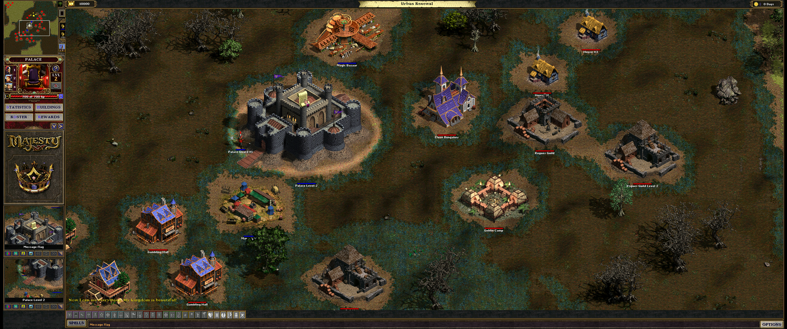

# [Majesty Gold HD][steam] — resolution mod

An unofficial fan mod that adds screen layouts [Majesty Gold HD][steam] doesn't ship with: ultrawide (21:9), 1440p
and 4K, so the interface fills the screen instead of sitting in a smaller frame in the middle.



*The game at 2560x1080, scaled to fill a 3440x1440 monitor with FSR. The original goes up to 1920x1200.*

The game picks its interface layout from `Data/UIData_<w>_<h>.dat` files, and only ships 13 of them, up to 1920x1200.
On a bigger screen it uses the closest one, in a black frame. The mod generates layouts for the sizes it lacks, from
the game's own files, on your computer.

- [Findings](docs/findings.md)

## Install

You need [Majesty Gold HD][steam] on Steam. Tested on Linux (Proton); Windows should work the same way, but hasn't
been tested yet ([#6](https://github.com/bruno-gelb/mghd_resolution_mod/issues/6)). GOG isn't supported yet
([#4](https://github.com/bruno-gelb/mghd_resolution_mod/issues/4)).

1. Quit the game.
2. Download the program from the latest release:
   - Windows: [mghd-resolution-mod-windows.exe][windows]. Double-click it.
   - Linux: [mghd-resolution-mod-linux][linux]. Make it executable and run it in a terminal:

     ```bash
     chmod +x mghd-resolution-mod-linux && ./mghd-resolution-mod-linux
     ```

3. It finds the game, says what it will do and asks first. It takes a minute or two: it makes layouts for common
   screen sizes (ultrawide 21:9 and 32:9, 1440p, 4K, 16:10 and more) and for your own screens.
4. Start the game, open **ADJUST SETTINGS** on the main menu and pick your resolution: the ones with a layout are
   green. The main menu shows the mod's version under the picture.

**Big screens, small text.** The game's interface doesn't scale, so at 3440x1440 or 4K the text gets small. For
bigger text, pick a lower resolution of your screen's shape, like 2560x1080 on a 3440x1440 screen: the graphics card
scales it up. Plain scaling makes the fonts blurry; a sharpening scaler fixes that: on Linux, [gamescope] with FSR
(`gamescope -w 2560 -h 1080 -W 3440 -H 1440 -S fit -F fsr -f -- %command%` in the game's Steam launch options), on
Windows the graphics driver's (NVIDIA Image Scaling, AMD RSR; not tested yet).

For a size that isn't in the list, like 1720x720 for 2x scaling: `--size 1720x720`.

## Uninstall

Run the program again and choose to remove the mod: it deletes the layouts it added and puts back the original
files it changed, byte for byte. Or have Steam put the game's files back (Properties, Installed Files, Verify
integrity of game files), then delete the `mghd-resolution-mod-backup` folder in the game folder.

## Principles

The same ones as the [Tzar mod](https://github.com/bruno-gelb/ttbotc_resolution_mod):

- **No game files.** The mod never ships any of the game's code or assets: its executable, data, art, music or
  text. Whatever it needs from the game is made on the player's computer, from their own copy: the new layouts, for
  one, are generated from the game's own.
- **Lightweight and strictly technical.** The mod fixes how the game runs on today's hardware (resolutions, screen
  layouts, scaling) and stays small and easy to remove. No gameplay or balance changes, no new content, no reworked
  art.

## Help wanted

Known problems and plans are [GitHub issues](https://github.com/bruno-gelb/mghd_resolution_mod/issues). Bug reports,
feature requests and help with testing are most welcome there.

## License

The mod's own files (code, documentation) are released under the [MIT License](LICENSE): use, change and share them
freely. That license covers only what's in this repository. The release programs also bundle Python, Click and
PyInstaller's bootloader, each under its own license: `--licenses` shows them, and each release has them in a
`THIRD-PARTY-NOTICES.txt` file next to each program.

## The game and its owners

- This is an unofficial fan project. It is not affiliated with, endorsed by or connected to
  [Cyberlore Studios][cyberlore], the original developer, to [Paradox Interactive][paradox], the publisher of
  [Majesty Gold HD][steam], or to any other publisher or store of the game.
- [Majesty Gold HD][steam], its executable, data files, artwork, music and trademarks belong to their respective
  owners. This repository contains none of them, and the mod will only ever ship its own files (new layouts, made
  from the player's own copy where needed), never the game's files. The screenshots show the game's art, which
  belongs to its owners too.
- The mod doesn't remove or get around any copy protection, and it won't. To use it, buy the game on [Steam][steam].
- The game's files are only changed on your computer, in your copy. Steam's "Verify integrity of game files" puts
  the originals back.

[steam]: https://store.steampowered.com/app/73230/
[windows]: https://github.com/bruno-gelb/mghd_resolution_mod/releases/latest/download/mghd-resolution-mod-windows.exe
[linux]: https://github.com/bruno-gelb/mghd_resolution_mod/releases/latest/download/mghd-resolution-mod-linux
[gamescope]: https://github.com/ValveSoftware/gamescope
[cyberlore]: https://en.wikipedia.org/wiki/Cyberlore_Studios
[paradox]: https://www.paradoxinteractive.com/
